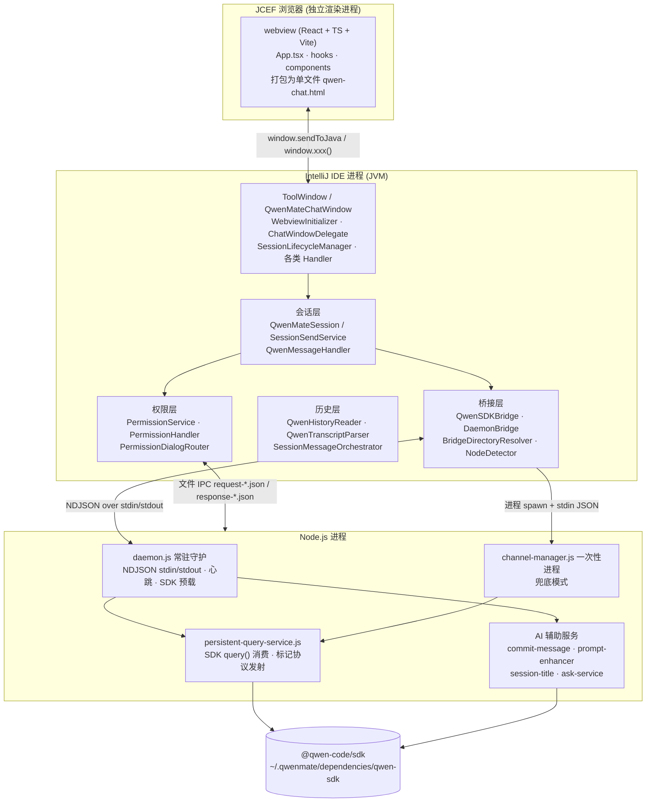

# QwenMate 技术设计文档

> 产品名：**QwenMate** ｜ 仓库/目录：`qwen-mate` ｜ 插件包名：`com.qwenmate` ｜ 用户数据目录：`~/.qwenmate`
>
> 本文覆盖总体架构、SDK 桥接、消息协议、权限系统、历史会话与构建交付的设计。
> 文中代码位置、参数为 2026-10-05 的实际状态；改动后请同步更新。

---

## 1. 项目定位与背景

QwenMate 是一个 JetBrains IDE 插件，为 Qwen Code（官方 TypeScript SDK `@qwen-code/sdk` 驱动）提供可视化聊天界面，Agent 交互全部在
IDE 内完成：流式输出与思考过程、工具卡片、权限审批对话框、会话历史与恢复、@文件引用与图片附件、MCP/Skills/Agents
管理、用量统计与成本核算、10 语言国际化。

设计上主要受三个约束：

1. **内网离线交付**：目标环境（银行内网）无外网。SDK、前端产物、Node 桥接层必须全部随插件包或离线包分发；打包链要绕过公司上传系统对归档内
   `.js/.html/.mjs` 后缀的扫描拦截。
2. **跨进程、跨语言**：UI 是 React/TypeScript（跑在 JCEF 里），宿主是 Java（IntelliJ Platform），引擎是
   Node.js（SDK）。三者的通信都要跨进程或跨语言，协议设计是本项目的重点。
3. **不依赖 CLI 的 UI**：Qwen Code CLI 有自己的终端交互，本项目通过 SDK 的 `query()` API + `canUseTool` 回调，在 IDE
   内接管审批、流式与会话恢复。

---

## 2. 总体架构

### 2.1 分层视图



四条边界：

| 边界              | 机制                                                                            | 方向     |
|-----------------|-------------------------------------------------------------------------------|--------|
| Webview ↔ Java  | JCEF 注入函数（`window.sendToJava` 上行；`window.xxx()` 回调下行）                         | 双向     |
| Java ↔ Node     | daemon：NDJSON over stdin/stdout；one-shot：进程 spawn + stdin JSON，stdout 标记行     | 双向     |
| Node ↔ SDK      | 动态 `import()` 加载 `@qwen-code/sdk`，`query()` 异步迭代器                             | Node 内 |
| Node ↔ Java（审批） | 文件 IPC（`request-*.json` + `response-*.json`，含 `ask-user-question-*` 变体，见 6.1） | 双向     |

### 2.2 仓库结构

```
qwen-mate/
├── src/main/java/com/qwenmate/     # Java 插件层（约 22 个包）
│   ├── ui/                        # WebviewInitializer、ChatWindowDelegate、ToolWindow
│   ├── session/                   # 会话、发送编排、消息回调、流合并
│   ├── provider/                  # qwen/ common/（桥接与历史读取）
│   ├── handler/                   # 前端消息处理器（约 30 个，消息类型 → Handler）
│   ├── permission/                # 权限服务、决策记忆、对话框路由
│   ├── bridge/                    # 路径定位、Node 探测、环境注入
│   ├── skill/ mcp/ settings/ ...  # 各功能域
│   └── startup/                   # BridgePreloader（项目启动预热）
├── src/main/resources/html/       # 构建产物 qwen-chat.html（gitignore，构建时生成）
├── webview/                       # React 前端源码（Vite + TS + Tailwind）
│   └── src/                       # App.tsx、hooks/、components/、i18n/（10 语言）
├── ai-bridge/                     # Node 桥接层（纯 ESM，无 npm 运行时依赖）
│   ├── daemon.js                  # 常驻守护进程
│   ├── channel-manager.js         # 一次性进程入口
│   ├── channels/                  # qwen-channel 命令路由
│   ├── services/                  # qwen/ + 三件套 + mcp-status
│   └── utils/                     # sdk-loader、marker-protocol、env-guards、no-flash
├── sdk-packages/                  # Qwen SDK 离线 tgz + install-offline 脚本
├── scripts/                       # package-offline / package-sdks / qwen-smoke
├── build.gradle                   # buildWebview、packageAiBridge、checkstyle 门禁
└── docs/                          # 本文档
```

### 2.3 运行时进程拓扑

- **JVM 进程**：IDE + 插件。JCEF 浏览器可能运行在同一进程（OSR）或远端代理（Android Studio 场景），代码对两者都做了兼容。
- **Node daemon（首选）**：启动后常驻，SDK 只加载一次；空闲 3 分钟后与 Java 协商退出（`idle_shutdown_request` →
  `idle_shutdown_ack/cancel` 握手）。
- **Node one-shot（兜底）**：每次请求 spawn 一个 `channel-manager.js` 进程，冷启动但零常驻状态。

---

## 3. IDE 集成与 Webview 层

### 3.1 Webview 生命周期（WebviewInitializer）

`WebviewInitializer`（`ui/WebviewInitializer.java`）负责创建与配置 JBCefBrowser：

1. **EDT 约束**：所有浏览器创建都在事件分发线程上执行；环境准备（Node 校验、HTML 生成）放到池线程，完成后回 EDT。
2. **桥接层预热**：初始化前检查 `BridgePreloader.getSharedResolver()` 的解压状态：`ai-bridge.zip` 若尚未解压，先显示
   loading 面板并注册 future 回调，解压完成后重新初始化，不阻塞 EDT。
3. **单文件加载**：页面是 `vite-plugin-singlefile` 打出的单文件 `qwen-chat.html`（无外部资源请求，规避 JCEF/CSP 的网络限制），由
   `HtmlLoader` 读取后经 `loadHTML` 注入。
4. **桥注入时机**：在 `CefLoadHandler.onLoadEnd`（主 frame）里注入 `window.sendToJava`、页面上下文变量（`pageGeneration`、初始
   IDE 主题、剪贴板路径等）；注入带快/慢两档重试，防止个别 JCEF 版本丢 `onLoadEnd`。

### 3.2 页面代际与分发门（PageGeneration + MessageDispatchGate）

webview 可能被重载（刷新、崩溃恢复）。旧页面残留的异步回调如果打进新页面，会造成状态错乱。为此：

- 每次页面加载分配一个递增的 **`pageGeneration`**，随注入脚本写进页面，前端所有上行消息都携带它。
- `MessageDispatchGate`（`ui/toolwindow/MessageDispatchGate.java`）在 Java 侧做两件事：
    - **代际过滤**：`runInDispatch(pageGeneration, task)` 只执行属于当前代际的消息；
    - **与 dispose 互斥**：`beginTeardown()` 等待在途分发结束并阻止新分发，保证
      dispose（浏览器销毁、进程清理）与消息处理不会交错，同时监视器只在分发期间持有，JCEF 线程不会等 EDT，避免 EDT↔JCEF 死锁。

权限对话框因此支持重载后重放：`PermissionHandler` 保留每个待决对话框的 JS 载荷与 `dialogToken`，webview 重新加载后在
`frontend_ready` 时幂等重放（已关闭或已被取代的请求不会复活）。

### 3.3 前后端桥协议

**上行（前端 → Java）**：`sendBridgeEvent(event, content)` 拼成 `"<event>:<content>"` 字符串，经 `window.sendToJava` 送达；Java
端 `MessageDispatcher` 按 `:` 切出类型与载荷，路由到注册的 `BaseMessageHandler` 子类：

```
AgentHandler  CliModelsHandler  ClipboardHandler  CliStatusHandler  ContextHandler
DependencyHandler  DiffHandler  HistoryHandler
InputHistoryHandler  McpServerHandler  NodePathHandler  NodeProcessHandler
PermissionHandler  PermissionModeHandler  ProjectConfigHandler  PromptEnhancerHandler
PromptHandler  QwenConfigHandler  SessionHandler  SettingsHandler  SkillHandler
SoundSettingsHandler  TabHandler  TokenTrackerHandler  WindowEventHandler …
```

`console.*` 转发（`{"type":"console.log",...}`）被单独拦截写入插件日志，不进分发器。

**下行（Java → 前端）**：`callJavaScript(functionName, args)` / `executeJavaScript(jsCode)`，统一经 `WebviewEventQueue` 排队后在
EDT 执行（转义由 `JsUtils.escapeJs` 处理）。前端在 `useWindowCallbacks` 中注册 `window.updateMessages`、
`window.onContentDelta`、`window.showPermissionDialog` 等回调。

**心跳与看门狗**：前端定时发 `heartbeat`，`WebviewWatchdog` 监测 UI 存活；配合 `WindowEventHandler` 的 `frontend_ready`、
`tab_loading_changed`、`history_render_complete`（DOM 提交确认）等生命周期信号。

> 前端自身架构（App.tsx 编排层、hooks 拆分、流式渲染节流）另有 `webview/src/ARCHITECTURE.md` 详述，本文不重复。

---

## 4. ai-bridge：Node 桥接层

### 4.1 定位与解压（BridgePathLocator / BridgeDirectoryResolver）

`ai-bridge/` 源码在打包时被压成 `ai-bridge.zip` + hash 放进插件 zip；运行时由 `BridgeDirectoryResolver`
解压到本地再执行。定位候选按优先级：

1. 显式配置：系统属性 `qwenmate.bridge.path` / 环境变量 `QWEN_MATE_BRIDGE_PATH`（历史名，保留兼容）；
2. 插件安装目录：`plugins/<PLUGIN_DIR_NAME>/ai-bridge`，其中 `PLUGIN_DIR_NAME = "qwen-mate"`，同时保留历史发行目录名
   `qwenmate`、`qwen-code-gui`、`idea-claude-code-gui` 作为候选。**发行 zip 根目录名与插件 id 不同名，改名时两处必须同步**
   （曾因只改 `rootProject.name` 导致 `Failed to find valid ai-bridge directory`）；
3. classpath 回溯：从 `CodeSource` 位置逐级向上找 `ai-bridge/`（开发态 `runIde` 场景）。

`BridgePreloader`（`ProjectActivity`）在项目打开后于后台线程提前触发解压，避免首次打开 ToolWindow 时冻结 EDT。

### 4.2 运行环境准备（NodeDetector / EnvironmentConfigurator）

- **Node 探测**：按配置路径 → 常见安装位逐个探测，探测任务注入 IntelliJ 托管线程池；结果可被 `PropertiesComponent`
  缓存（设置页可手填路径）。
- **环境注入**：
    - 临时目录、`QWEN_MATE_PERMISSION_DIR`（权限 IPC 目录）、`QWEN_MATE_SESSION_ID`、安全网超时；
    - Qwen API 配置：`QWEN_API_KEY`/`DASHSCOPE_API_KEY`/`OPENAI_API_KEY`、`QWEN_BASE_URL` 等（设置页存储优先，环境变量兜底）；
    - **WSL 跨界**：node 是 WSL 二进制时，把 IPC 目录转成 `/mnt/...` 路径并追加进 `WSLENV`，否则权限桥会挂死（daemon 启动时打印的
      `bridge env` 诊断行用于排查这个问题）。

### 4.3 daemon 模式（首选）

`daemon.js` 是常驻进程，协议为 **NDJSON**（每行一个 JSON）：

```jsonc
// Java → Node（stdin）
{"id":"1","method":"qwen.send","params":{...,"env":{...}}}
{"id":"2","method":"heartbeat"}
{"method":"idle_shutdown_ack","params":{"token":1}}

// Node → Java（stdout）
{"type":"daemon","event":"ready","pid":123}              // 生命周期事件
{"id":"1","line":"[STREAM_START]"}                       // 命令输出行（标记协议）
{"id":"1","stderr":"..."}                                // stderr 行
{"id":"1","done":true,"success":true}                    // 命令结束
{"id":"2","type":"heartbeat","ts":123,"runtimes":{...}}  // 心跳/状态响应
```

关键机制：

- **stdout 拦截与请求复用**：`process.stdout.write` 被包装，有活动请求时把每行日志包成 `{id, line}` 供 Java 按 id 分流；
  `console.log`/`console.error` 同步重定向。带外事件（如标题生成）用 `writeRawLine` 直写，避免被错误打上活动请求标签。
- **`process.exit` 拦截**：命令内代码调用 `process.exit()` 不会杀死 daemon，而是转成该请求的 `done` 信号后抛错展开栈。
- **命令队列**：命令串行执行（共享 `activeRequestId`）；心跳/status/`qwen.setPermissionMode` 绕过队列并发处理。
- **空闲回收**：3 分钟无命令且无活动 turn → 先清理运行时，再向 Java 发 `idle_shutdown_request(token)`，由 Java
  侧的请求注册表原子判定"确认无新请求"后回 ack；期间到达的命令被暂存，取消则重放。
- **SDK 预载**：`ready` 事件先发（不等 SDK），加载放后台；首个 send 通过 `ensureQueryFn` 等待在途加载。
- **环境守卫**（`utils/env-guards.js`）：请求 `params.env` 合并时，拦截 `NODE_OPTIONS`/`LD_PRELOAD`/`DYLD_*` 等代码注入类变量（防恶意项目
  `settings.json` 注入），同时不让陈旧的 settings 环境覆盖前端本轮的模型/上下文/推理选择；合并值在请求结束后还原。

Java 侧 `DaemonBridge` 的对应参数：

| 参数                                    | 值    | 语义                   |
|---------------------------------------|------|----------------------|
| `DAEMON_START_TIMEOUT_MS`             | 30s  | 启动等待 ready           |
| `HEARTBEAT_INTERVAL_MS`               | 15s  | 心跳周期                 |
| `HEARTBEAT_TIMEOUT_MS`                | 45s  | 连续 3 次未响应判死          |
| `ACTIVE_REQUEST_HEARTBEAT_TIMEOUT_MS` | 180s | 有活动请求时放宽判死           |
| `MAX_RESTART_ATTEMPTS`                | 3    | 30s 稳定窗口内最多自动重启 3 次  |
| `STDERR_RING_CAPACITY`                | 40   | 保留最近 stderr 尾巴用于报错诊断 |

输出解析：非 `{` 开头的行视作 SDK 日志丢弃；`type=daemon/heartbeat/status` 走生命周期分支；其余按 `id` 找 `PendingRequest`，
`done` 结束请求、`line` 转给 `MessageCallback.onLine`、`stderr` 转给 `onStderr`。心跳探针避免在网络无响应时长时间等待。

### 4.4 one-shot 模式（兜底）

daemon 启动失败/判死/退避期内（`DAEMON_RETRY_DELAY_MS = 60s`），`QwenSDKBridge.sendMessage` 回落到：

```
node channel-manager.js <provider> <command>   ← JSON 参数走 stdin
```

`channel-manager.js` 按 `provider`（`qwen`/`system`）路由：qwen 进 `channels/qwen-channel.js`，system 由内置处理器响应 SDK
状态检查类命令。两个进程语义问题需要特别处理：

- **stdout 刷盘竞态**：成功路径用 `writeJsonAndExit()`，先等 `stdout.write` 完成回调再 `process.exit`，另有 5s
  定时强制退出兜底；错误路径同理，避免大 JSON（如历史列表）被截断。
- **自然退出**：分发完成后只设 `process.exitCode = 0`，让进程排空 I/O 后自行退出。

### 4.5 SDK 加载（utils/sdk-loader.js）

`loadQwenSdk()` 的要点：

1. SDK 位置固定为 `~/.qwenmate/dependencies/qwen-sdk/`（离线包解压目标），不存在时报 `SDK_NOT_INSTALLED:qwen`；
2. 加载前校验关键传递依赖 `@modelcontextprotocol/sdk` 存在，缺失给出可操作的重装提示；
3. 用 `createRequire(入口文件)` 锚定解析，并设置 `NODE_PATH` 兜底。Windows 下 ESM 解析器对 `node_modules` 中 scoped 包（
   `\@` 转义）处理有问题，不锚定会 import 失败；
4. 结果进程内缓存（`sdkCache` + `loadingPromises` 去重并发加载）。

---

## 5. Qwen SDK 桥接

### 5.1 发送主链路（QwenSDKBridge）

```
SessionSendService.sendToQwen
  → QwenSDKBridge.sendMessage(channelId, message, sessionId, epoch, cwd,
                              attachments, permissionMode, model, openedFiles,
                              agentPrompt, streaming, disableThinking,
                              reasoningEffort, callback)
      ├─ getDaemonBridge() 成功 → QwenDaemonRequestExecutor.sendStreamCommand("qwen.send", …)
      │      stdin: {"id", "method":"qwen.send", "params"}；stdout {id,line} → processOutputLine
      └─ 否则 → executeStreamingCommand(channel-manager 一次性命令)
```

`getDaemonBridge()` 是 get-or-create：活着直接用；空闲退役的走 `ensureRunning()` 复活；否则新建（失败/退避期内返回 null 触发
one-shot）。另有 `prewarmDaemonAsync`（`qwen.preconnect`，45s 超时）在会话建立时预热，首轮消息不必等冷启动。

发送前的 cwd 处理：`PathUtils.guardWorkingDirectory` 把工作目录限制在项目基址/合理范围内，越界会被纠正并记日志。

### 5.2 persistent-query-service：SDK 消费与会话保持

`ai-bridge/services/qwen/persistent-query-service.js` 是 daemon 模式的核心：

- **运行时注册表**：`runtimes` 以 `sessionId::cwd::model` 为 key 缓存会话状态；`activeTurns` 记录每个进行中 turn 的
  `AbortController`，支持 `abort`/`resetRuntime`。
- **调用形态**：
  ```js
  const result = sdk.query({ prompt, options });
  // options: { cwd, permissionMode, includePartialMessages, model,
  //            resume: sessionId, canUseTool, abortController,
  //            timeout: { canUseTool } }
  ```
  有 `sessionId` 时走 `resume` 恢复会话（多轮上下文由 SDK 侧管理）。`timeout.canUseTool` 把 SDK/CLI 的审批回调超时（默认
  60s，超时即取消命令）拉伸到整个对话框窗口（安全网 env + 30s），见 6.1。
- **权限模式归一**：`plan / default / auto-edit / auto / yolo` 五档，兼容旧 id（`acceptEdits→auto-edit`、
  `bypassPermissions→yolo`），非法值回落 `default`，历史会话里存的旧模式因此保持原语义。
- **附件**：`image/*` 的 base64 转成 SDK content block（`{type:'image', data, mimeType}`），与文本块拼成 prompt 数组。
- **流消费**：`consumeQueryStream()` 把 SDK 异步迭代器的 `system/assistant/partial_assistant/user/result`
  消息翻译成标记协议（见下节）；无 `result` 结束也兜底闭合流。
- **回合结束的 fire-and-forget**：新会话（非 resume）首轮成功后触发 `maybeGenerateSessionTitle`：按 sessionId
  去重、失败静默、瞬时错误冷却重试，不影响主请求。

### 5.3 标记协议（marker-protocol）

ai-bridge 与 Java 之间用行式标记传输流式语义（一行一事，JSON 载荷紧跟其后）：

| 标记                                  | 载荷          | 语义                                               |
|-------------------------------------|-------------|--------------------------------------------------|
| `[MESSAGE_START]` / `[MESSAGE_END]` | —           | 消息级边界                                            |
| `[STREAM_START]` / `[STREAM_END]`   | —           | 流级边界（驱动 UI 转圈/收尾）                                |
| `[BLOCK_RESET]`                     | —           | 工具调用后的结构性分段，清空 delta 累积器                         |
| `[CONTENT_DELTA] "<json-string>"`   | JSON 字符串    | 正文增量（JSON 编码保证行原子与前导空白）                          |
| `[THINKING_DELTA] "<json-string>"`  | JSON 字符串    | 思考增量                                             |
| `[CONTENT]` / `[THINKING]`          | 原始文本        | 全量快照                                             |
| `[MESSAGE] <json>`                  | Claude 形状消息 | 完整消息（assistant/user/tool_use/tool_result/result） |
| `[SESSION_ID] <id>`                 | 文本          | 会话 id（Java 据此接续 resume）                          |
| `[USAGE] <json>`                    | usage JSON  | token 用量（Java 归一成 snake_case 存储）                 |
| `[SEND_ERROR] <json>`               | `{error}`   | 发送阶段错误                                           |

Java 端解析集中在 `QwenSDKBridge.processOutputLine`。`[DEBUG]`/`[DIAG-` 等诊断行只进日志。

**daemon 封装差异**：one-shot 模式下标记行直接是 stdout；daemon 模式下每行被包成 `{id, line}`，由 `DaemonBridge` 解包后交给同一个
`processOutputLine`。两种模式对 Java 侧等价，daemon 因此可以直接替换 one-shot。

### 5.4 消息流水线（Java → 前端）

```
标记行 → QwenSDKBridge.processOutputLine → MessageCallback (QwenMessageHandler)
  → SessionState 消息列表（MessageMerger 合并快照/保留 mid-turn tool_use）
  → CallbackHandler.notify* 
  → webview 回调（onContentDelta / updateMessages / showPermissionDialog …）
  → useStreamingMessages（50ms 节流、block 边界对齐、turn 计数）
  → React 渲染
```

`QwenMessageHandler` 的处理要点：

- **assistant 气泡所有权**：`stream_start` 后只向本流专属气泡追加内容，避免与上一轮回答粘连；`block_reset` 清累积器承接工具后的新文本段。
- **user 回显去重**：ACP/user 回显不新增气泡：发送时的 user 消息由 `SessionSendService` 负责入列，回显只 patch 匹配项，否则
  UI 会出现重复用户消息。
- **usage 竞态保护**：最终 `[MESSAGE]` 覆盖 raw 前先提取已 stamp 的 usage；`stream_end` 时补推一次上下文用量，防止上下文环被并行覆盖清零。
- **结束兜底**：`onComplete` 发现没有 `stream_end` 就被调用时强制清理（记 WARN），保证 loading/工具卡不会卡死。

---

## 6. 权限系统

### 6.1 分层闸门（Node 侧）

**第一道：模式策略（生效链路 `persistent-query-service.buildCanUseTool`）**：大多数请求在这一层直接放行，不进入审批：

| 模式                        | 策略                                             |
|---------------------------|------------------------------------------------|
| `yolo`（bypassPermissions） | 全部放行（CLI 自己也不问了，这里做兜底回调）                       |
| `plan`                    | 只读工具放行，写/ shell 一律 deny（镜像 CLI 的 plan 限制，第二道闸） |
| `auto-edit`               | 只读放行 + `edit/write_file/notebook_edit` 预批，其余问  |
| `auto` / `default`        | 只读放行，其余进入审批通道；auto 模式下 CLI 的分类器先过一遍            |

只读白名单（`READ_ONLY_TOOL_NAMES`）与自动编辑白名单（`AUTO_EDIT_TOOL_NAMES`）同时接受小写 wire id（`read_file`/`edit`）与
`Read/Edit/...` 形态别名，保证 SDK 报哪种命名都能匹配。

**第二道：交互审批（文件 IPC）**：需要人决策时，`buildCanUseTool` 在 default 档调用 `requestPermissionFromJava`（
`services/qwen/persistent-query-service.js`，实现落在 `services/qwen/permission-file-ipc.js`）：

1. 从环境读取 `QWEN_MATE_PERMISSION_DIR` / `QWEN_MATE_SESSION_ID` / `QWEN_MATE_PERMISSION_SAFETY_NET_MS`（缺 dir 或
   sessionId 非法时立即 deny 并带原因，不挂起）；
2. 原子写入 `request-<sessionId>-<requestId>.json`（`{requestId, toolName, inputs, cwd}`，临时文件 + rename，防半写）；
3. 轮询 `response-<sessionId>-<requestId>.json`，**仅显式布尔 `allow` 解析**（半写 JSON / 非布尔值继续等），拿到后删除
   response 文件并 resolve `canUseTool`；`pendingPermissions` 表挂起期间与 abort 联动（turn 取消 → deny + 清掉残留 IPC
   文件，不留幽灵对话框）；
4. Node 侧兜底定时器 = 安全网 env + 10s（排在 Java 对话框安全网之后），SDK/CLI 的 `timeout.canUseTool` = 安全网 env +
   30s（默认 60s 会在对话框还没关时就取消命令）。

**文件 IPC（生效链路）**：Java 侧 `PermissionService`/`PermissionRequestWatcher`/`PermissionFileProtocol` 自
`ChatWindowDelegate.setupPermissionService` 起常驻（轮询 + 对话框 shower 注册），Node 侧写入方恢复后整条链生效：决策记忆、Edit/Write
diff 预览、按 cwd 路由对话框、系统对话框兜底、安全网超时全部复用（流程见 6.2）。历史上曾有过一版 `[PERMISSION_REQUEST]`
流内标记通道（回写从未接线，2026-10-05 已随本修复移除）。

**AskUserQuestion（答案收集，同族文件 IPC）**：`ask_user_question` 工具不是审批而是**答案收集**，`buildCanUseTool` 在所有模式（含
yolo/plan）最先拦截——CLI 对裸 allow 的处理是"无答案继续"（`buildAllowConfirmationPayload` 只从 `updatedInput.answers`
取答案），不带 answers 的放行会直接产生 "No valid answers were provided"。链路：`requestAskUserAnswers` 写
`ask-user-question-*.json` → Java `handleAskUserQuestionRequest` → 前端 `showAskUserQuestionDialog` 选项对话框（带提醒
toast/提示音）→ `ask_user_question_response` 桥事件 → `ask-user-question-response-*.json {answers}` → Node 轮询后以
`updatedInput = {...input, answers}` resolve。**答案 key 归一在 Node 桥完成**：前端按问题文本作 key、CLI 只认十进制索引（
`parseAnswerQuestionIndex` 要求 `String(index)===key`），`normalizeAskAnswers` 负责文本→索引映射与多选数组的 `', '`
拼接。降级路径：无对话框窗口/超时 → Java 写空 `answers` → CLI 记 "No valid answers" 继续。**已知缺口**：`plan-approval-*`
（exit_plan_mode）仍是 Java 单侧休眠，Node 无写入方。

### 6.2 Java 侧决策与展示（文件 IPC → 前端对话框）

> Node 写入请求文件后即按此执行（写入方见 6.1）。

```
PermissionRequestWatcher（轮询 IPC 目录）
  → PermissionService.handlePermissionRequest
      1) 工具级决策记忆命中？→ 直接回写 response
      2) Edit/Write 类工具 → DiffReviewService 先 diff 预览
      3) 参数级决策记忆命中？→ 回写
      4) PermissionDialogRouter 按 cwd 匹配项目 → 该窗口的 PermissionDialogShower
         → callJavaScript("showPermissionDialog", …)（前端对话框）
      5) 找不到窗口 → 系统级兜底对话框
  → 前端用户决策 → sendBridgeEvent('permission_decision', …)
  → PermissionHandler 校验 dialogToken → 写 response 文件 → Node 放行/拒绝
```

配套机制：

- **决策记忆**：工具级（"总是允许 Edit"）与参数级（输入 hash 匹配）两层，`PermissionDecisionStore` 管理，可一键清空；
- **对话框队列与重放**：前端多请求排队（`useDialogManagement`），Java 侧保留载荷支持 webview 重载后重放；`dialogToken` 独立于
  requestId，防止会话复用 id 时误关/误复活；
- **AskUserQuestion / Plan 审批**：同一套文件 IPC（`ask-user-question-*`、`plan-approval-*` 变体），AskUserQuestion 还带提醒（系统
  toast + 提示音）与安全网超时（防对话框泄漏挂住 Node）；ask 的 Node 写入方已恢复（见 6.1），`plan-approval-*` 仍缺 Node
  写入方休眠中；
- **超时**：对话框默认 300s（最小 30s，设置可调），安全网 env = 对话框超时 + 60s 缓冲；Node 兜底定时器 = env + 10s、SDK
  `timeout.canUseTool` = env + 30s（三层依次兜底，Java 对话框始终最先应答）；权限模式中 `plan → DENY_ALL`、
  `bypassPermissions → ALLOW_ALL`、`acceptEdits → ACCEPT_EDITS` 由 `QwenMateSession.setPermissionMode` 同步到
  `PermissionManager`。

### 6.3 模式解析（前端请求 ↔ 会话状态）

`SessionSendService.resolveEffectivePermissionMode`：本轮请求显式带的模式优先，否则用会话记忆，再否则 `default`；经
`SessionState.migratePermissionMode` 迁移旧 id 后校验。日志以 `[ModeSync][Backend]` 前缀贯穿 requested/session/effective
三值，便于排查"为什么没弹审批"类问题。

---

## 7. 会话与历史

### 7.1 存储布局

Qwen Code CLI 把会话以 JSONL 落盘，QwenMate 只读复用该布局，不另建存储：

```
~/.qwen/projects/<sanitizeCwd(cwd)>/chats/<sessionId>.jsonl     # 主会话转写
~/.qwen/projects/<key>/subagents/<sessionId>/agent-<id>.jsonl    # 子代理转写
~/.qwenmate/                                                     # 产品自有数据
    ├── config.json           # 设置（AI 标题开关等，Java/Node 双端读取）
    ├── session-titles / favorites / input-history …
    └── dependencies/qwen-sdk/ # SDK 离线安装位
```

`sanitizeCwd` 复刻 CLI 算法（可选小写 + 非字母数字转 `-`）；`projectKeyCandidates` 同时生成小写与原样两套 key：CLI 在
Windows 上先小写，而大小写敏感主机上的转写要用原样 key 才能找到。

### 7.2 读取链路（QwenHistoryReader）

```
webview 切到 history 视图 → sendBridgeEvent('load_history_data', provider)
  → HistoryHandler → HistoryLoadService（异步）
      → QwenHistoryReader
      → QwenHistoryIndexService：索引缓存 + 增量刷新
      → 合并收藏（favorites-service）与自定义标题（session-titles）
      → executeJavaScriptQueued('updateHistoryData', json)
  → 前端 useHistorySessions：去重（sessionId 级，时间戳/计数/收藏取最优合并）
      → 收藏置顶 + 标题搜索过滤
```

- **索引复用**：`SessionIndexManager` 持久化每会话的 mtime/size/entrypoint/model；文件未变直接复用条目，变了只重建该条目，避免每次打开历史全量解析几百个
  JSONL；`SessionIndexCache` 再加一层进程内缓存。
- **转写解析**：`QwenTranscriptParser.parse(file, includeSidechain)` 宽松逐行解析（坏行跳过不抛），`subagent` 场景保留
  `isSidechain` 记录、主会话剔除。
- **恢复**：`getSessionMessagesPage` 分页加载单会话消息（回翻用），`SessionMessageOrchestrator` 负责把历史与 live
  流合并：历史滞后时不清除 live 工具块，历史页激活用 `MessageDispatchGate` 拒绝过期消息。
- **删除**：sessionId 白名单校验（`[A-Za-z0-9._-]+`，与 Node 侧 `SESSION_TITLE_PATTERN` 对齐）防路径穿越；
  `HistoryDeleteService` 同步删转写与产品侧元数据。
- **子代理面板**：`SubagentHistoryService` 按 `agentId → toolUseId(sidecar meta) → description` 三级回退定位
  `agent-*.jsonl`，无数据时降级为"空且已完成"面板。

### 7.3 会话生命周期（Java 侧）

`QwenMateSession` 是对外门面，内部拆分 `SessionSendService`（发送编排）、`SessionMessageOrchestrator`（历史/直播编排）、
`SessionLifecycleManager`（新建/恢复/切换/清理）、`SessionProviderRouter`（provider 解析，未知值回落 qwen）。会话身份由
sessionId + runtimeSessionEpoch 共同标识：epoch 用于区分同一 sessionId 的不同运行时代，防止恢复会话时把旧流的输出打进新流。

---

## 8. AI 辅助服务（三件套 + ask 通道）

提交信息生成、提示词增强、会话自动标题共用一个一次性问答通道
`ask-service.askOneShot({provider, prompt, model, cwd, onDelta, timeoutMs})`：

- 该通道的 `canUseTool` 恒为 deny，one-shot 生成不执行工具，辅助功能不会产生副作用；
- provider 仅支持 `qwen`（`ASK_PROVIDERS = ['qwen']`），其它值回落 qwen 引擎；
- 流式 delta 用 `[CONTENT_DELTA]` 标记上行，Java 侧（如 `CommitAIClient`）边收边在 EDT 合并预览（`scheduleProgress`
  合流，避免事件线程积压）。

各服务要点：

| 服务    | Node 入口                             | Java 触发                                                           | 关键设计                                                                                                           |
|-------|-------------------------------------|-------------------------------------------------------------------|----------------------------------------------------------------------------------------------------------------|
| 提交信息  | `services/commit-message.js`        | `GitCommitMessageService` → `CommitAIClient`（90s 超时，可 cancel 杀进程） | prompt 含 spec+diff 由 Java 组装；输出包裹 `<commit>`，`{{NEWLINE}}` 编码保证单行标记                                            |
| 提示词增强 | `services/prompt-enhancer.js`       | `PromptEnhancerHandler` / `PromptEnhancerProcessRunner`           | 模型解析优先 Java 侧 effectiveProvider，`auto` 时跟随聊天模型；`computeMaxTokens` 按输入长度自适应（2048~8192）                          |
| 会话标题  | `services/session-title-service.js` | 无需 Java 触发（daemon 内 fire-and-forget）                              | 30s API 超时（思考型模型可 >15s 才出 JSON）；结果以 `title_generated` daemon 事件上行，Java 立即推给前端改标题；开关读 `~/.qwenmate/config.json` |

---

## 9. 外围能力

- **MCP**：`McpServerHandler`（配置 CRUD，读写 `~/.qwen/settings.json` 的 mcpServers，Java 与 Node 读写三链一致）+
  `services/mcp-status/`（status/tools 探测：stdio 子进程管理、HTTP JSON-RPC 与 SSE 双解析、指数退避重试、`Mcp-Session-Id`
  会话续用、env 占位符展开）。
- **Skills**：`SkillService` + `SkillFrontmatterParser` 解析 skill 目录 frontmatter，`SlashCommandRegistry` 生成斜杠命令；启动时抓取
  CLI 命令列表。
- **Agents**：`AgentHandler` 全套 CRUD/导入导出；agent prompt 在发送时按"全局设置 or 每 Tab 选择"注入用户消息尾部（
  `## Agent Role and Instructions`）。
- **编辑器上下文**：`EditorContextTracker`/`SelectionTextUtils` 收集选区、打开文件，`ContextHandler` 的 `addSelectionInfo`/
  `addCodeSnippet` 注入前端；`IgnoreRuleParser`（gitignore 语义）过滤 @文件引用候选。
- **用量与成本**：`[USAGE]` 归一为 snake_case 存进消息 raw；`UsageCostCalculator` + `provider/pricing/QwenPricingTable`
  按回合核算成本；`TokenTrackerHandler` 处理上下文环展示（`buildContextUsage` 合成：Qwen ACP 只给聚合用量，used/free 两格由
  Java 合成）。

---

## 10. 构建、打包与离线交付

### 10.1 Gradle 构建链

```
gradlew buildPlugin
  ├─ buildWebview (Exec)          # webview: tsc && vite build → copy-dist 同步 qwen-chat.html 到 resources
  ├─ packageAiBridge              # ai-bridge → ai-bridge.zip + hash
  ├─ compileJava / processResources（mustRunAfter buildWebview）
  ├─ checkstyleMain               # 打包门禁：unused import 直接 FAIL
  └─ prepareSandbox → build/distributions/qwen-mate-<ver>.zip（约 74MB，含 sdk-packages 与 ai-bridge）
```

要点：

- **前端产物不入库**（`.gitignore`：`qwen-chat.html`、`webview/dist`、`build/`），由构建任务再生；验收 webview 改动要看构建日志里有
  `buildWebview`/`copy-dist` 同步行。
- 改 `rootProject.name` 时必须同步 `BridgePathLocator.PLUGIN_DIR_NAME` 与 legacy 候选，否则 zip 解压目录名找不到桥（有回归测试
  `BridgeArchiveLocatorTest`）。
- `settings.gradle` 走阿里云镜像（内网构建），`org.gradle.daemon=false`。
- JDK 17（`local.properties` 指定）。

### 10.2 离线双交付物（scripts/package-offline.mjs）

公司上传扫描会按后缀拦截归档内的 `.js/.html/.mjs`，因此交付包做 **6 层嵌套 tar.gz + 外层 zip**，层名刻意不含产品/供应商词：

```
build/offline/
  qwen-gui-offline.zip → pkg-l1..l6.tar.gz → qwen-mate-<ver>.zip
  qwen-sdk-offline.zip → sdk-l1..l6.tar.gz → sdk-packages/（tgz + install-offline.bat/sh）
```

安装侧：插件 zip 走 IDE"从磁盘安装"；SDK 解压到 `~/.qwenmate/dependencies/qwen-sdk/`（随包 `install-offline.bat/sh`
），或联网环境用"SDK 依赖管理"页在线装。`package-sdks.mjs` 负责刷新 SDK staging。

### 10.3 Windows 专项

- **cmd 闪窗**：`utils/no-flash.cjs` 在 daemon/channel-manager 入口首行加载，抑制 Node 子进程的控制台窗口闪烁（
  `CREATE_NO_WINDOW` 类处理）；根因排查报告见工作区 `cmd闪窗排查报告.md`。
- **HOME 归一**：IDE 注入 WSL 风格 `HOME=/mnt/c/...` 但子进程是 MSYS bash 时，daemon 启动即归一为 `C:/...`，否则 git 找不到
  `.gitconfig`。
- **登录 shell 环境探测**：GUI 启动的 IDE 不加载 shell rc，daemon 启动时探测登录 shell 并按白名单并集式补 `PATH`/
  `JAVA_HOME` 等（并集而非替换，避免吞掉 Java 侧已注入的路径）。

---

## 11. 测试与质量

| 链       | 位置                        | 规模（2026-10-05）               | 命令                                                             |
|---------|---------------------------|------------------------------|----------------------------------------------------------------|
| Java 单测 | `src/test/java`           | 119 个测试类（909 个用例，2026-10-05） | `gradlew test`                                                 |
| 前端单测    | `webview/src/**/*.test.*` | 168 个测试文件（1561 个用例）          | `cd webview && npm test`（vitest + `tsc -p tsconfig.test.json`） |
| Node 单测 | `ai-bridge/**/*.test.*`   | 14 个测试文件（109 个用例，node:test）  | `node --test`                                                  |
| E2E     | `webview/e2e`（Playwright） | 已配置，回归未常态化跑                  | `npm run test:e2e`                                             |
| 冒烟      | `scripts/qwen-smoke.mjs`  | SDK 链路手工冒烟                   | `node scripts/qwen-smoke.mjs`                                  |

合约测试思想贯穿三链，例如：`BridgeArchiveLocatorTest`（zip 目录名回归）、`EnvironmentConfiguratorPermissionTimeoutTest`
（WSLENV 传播）、`marker-protocol.test.js` ↔ Java 侧 `QwenMessageHandler` 解析（两端对同一协议各测一半）、
`PermissionHandlerTest`/`PermissionServiceRefactorTest`（决策记忆与对话框重放）。

**打包前的最小验证序列**：`gradlew test` → `cd webview && npm test` → `cd ai-bridge && node --test` →
`gradlew buildPlugin`（checkstyle 门禁在最后一步才暴露）。

---

## 12. 安全设计要点

1. **危险环境变量过滤**（daemon 请求 env 合并）：拒绝 `NODE_OPTIONS`/`LD_PRELOAD`/`DYLD_*` 等，防恶意项目 `settings.json` 借
   env 注入代码。
2. **权限响应严格解析**：权限文件协议约定仅显式布尔 `true` 才算放行，防半写文件被误判成放行（Node/Java 两端各守一半，见
   6.1）。
3. **sessionId/path 白名单**：历史读取、标题生成、子代理定位统一 `[A-Za-z0-9._-]+`，`isNonEmptySessionId` 拒绝 `..`、分隔符、
   `.`。
4. **前端输出消毒**：markdown 经 DOMPurify；`openBrowser` 只放行 `http/https/mailto`（纵深防御，`file:`/`javascript:`
   显式拒绝）；文件/类名打开走合法性校验（FQCN 候选、路径规范化）。
5. **cwd 守卫**：发送前把工作目录约束到项目范围内（`PathUtils.guardWorkingDirectory`），越界纠正并留痕。
6. **one-shot 不执行工具**：AI 辅助功能的 `canUseTool` 恒 deny。
7. **危险路径筛查层已删除**：原休眠的路径/Bash 绕过筛查模块（`permission-safety.js`）已随 Node 侧清理移除（本就无生效链路）；
   `plan` 模式仍靠 `buildCanUseTool` 的只读白名单 deny 写操作。

---

## 13. 已知的兼容性保留（勿当残留删除）

去残留清理（2026-10-03，详见工作区 `去残留清理报告.md`）后仍有**功能性保留**：

- 环境变量守卫仅余 `ANTHROPIC_MODEL`（Qwen CLI anthropic provider 的模型路由）；`.claude` 布局扫描已随 2026-10-03 二轮清理移除；
- CC GUI 归属行（README/LICENSE，MIT 合规）保留；原 `cc-gui-*` 字体/CSS/localStorage 标识已全部更名（见去残留报告 D6）；
- 环境变量名 `QWEN_MATE_BRIDGE_PATH`（`qwenmate.bridge.path` 的 env 形式）、权限目录默认名 `qwenmate-permission`（Node 端由
  QWEN_MATE_PERMISSION_DIR 注入，无本地默认值）;
- webview 内 `'claude'|'codex'` 作为 provider 标识字符串大面积存在（分散逻辑/持久化，改动有行为风险），未动。

---

## 附录：关键入口速查

| 关注点             | 入口文件                                                                                                                  |
|-----------------|-----------------------------------------------------------------------------------------------------------------------|
| Webview 初始化/桥注入 | `src/main/java/com/qwenmate/ui/WebviewInitializer.java`                                                               |
| 前端消息分发          | `src/main/java/com/qwenmate/ui/ChatWindowDelegate.java` → `handler/*`                                                 |
| 发送编排            | `src/main/java/com/qwenmate/session/SessionSendService.java`                                                          |
| 标记解析（Qwen）      | `src/main/java/com/qwenmate/provider/qwen/QwenSDKBridge.java`                                                         |
| daemon Java 侧   | `src/main/java/com/qwenmate/provider/common/DaemonBridge.java`                                                        |
| daemon Node 侧   | `ai-bridge/daemon.js`                                                                                                 |
| SDK 查询/流翻译      | `ai-bridge/services/qwen/persistent-query-service.js`                                                                 |
| 标记协议定义          | `ai-bridge/utils/marker-protocol.js`                                                                                  |
| 权限审批（流内标记）      | `ai-bridge/services/qwen/persistent-query-service.js` ↔ `src/main/java/com/qwenmate/provider/qwen/QwenSDKBridge.java` |
| 历史读取            | `src/main/java/com/qwenmate/provider/qwen/QwenHistoryReader.java`                                                     |
| 桥路径定位           | `src/main/java/com/qwenmate/bridge/BridgePathLocator.java`                                                            |
| 打包              | `build.gradle`、`scripts/package-offline.mjs`                                                                          |

